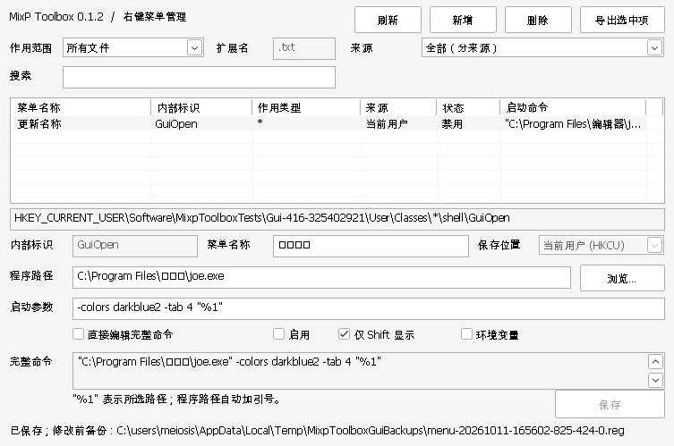

# MixP Toolbox

面向 Windows XP 的轻量桌面工具箱，使用 **Borland C++Builder 6** 开发。当前版本为 **0.1.2**，实现静态右键菜单项的新增、查看、搜索、修改、删除和备份恢复。



## 当前功能

- 默认“全部范围”汇总两个来源下各文件类型的静态菜单，包含文件夹、驱动器、扩展名及 ProgID；表格显示作用类型。
- 可单独查看所有文件、文件夹、驱动器、文件与文件夹，以及指定扩展名对应文件类型的菜单项。
- 分别管理当前用户和所有用户的配置，可按来源筛选。
- 按菜单名称、内部标识或启动命令即时搜索。
- 设置菜单名称、程序路径和默认启动参数，自动给程序路径加引号。
- 直接编辑完整命令，保留已有命令的原始内容。
- 启用/禁用、仅按住 Shift 时显示、环境变量命令。
- 修改或删除前自动备份整个菜单分支，也可手动导出选中项。
- 中文界面、中文菜单名称及中文程序路径。

## 在 XP 上使用

便携包解压后直接运行 `mixp-toolbox.exe`，不需要安装程序或额外的 Borland 运行库。目标是 **32 位 Windows XP**；实际 XP Explorer 菜单显示和启动行为仍需在 XP 中验收，当前自动验证环境为 macOS 上的 Wine。

启动后默认查看“全部范围”，点击“刷新”重新读取菜单。单独选择“所有文件”时，仅查看对所有文件通用的静态菜单，文件类型专属菜单在“全部范围”或对应扩展名中查看。空表或搜索无匹配时，表格上方会显示原因和操作提示。

点击“新增”后，下方输入区启用，位置提示显示“新增模式”，按钮变为“添加菜单”。在“全部范围”中点击“新增”，目标会切换为“所有文件”；添加到其他范围时先选择范围再新增。点击新增不会立即写注册表。

界面采用紧凑布局，支持拉伸和最大化；窗口启动时按当前屏幕工作区调整位置与大小。缩小窗口时保留下方编辑区，表格列宽会自动适配。长命令可以在下方完整命令框中换行、滚动查看；鼠标悬停可查看完整路径、参数、菜单命令和保存状态。注册表位置框支持选择、复制及横向滚动。

为所有文件添加 JOE 菜单的示例：

1. 作用范围选择“所有文件”，点击“新增”。
2. 内部标识填写 `Mixp.Joe`，菜单名称填写“使用 JOE 编辑”。内部标识用于区分菜单项，同一范围和保存位置不能重名。
3. 保存位置选择“当前用户 (HKCU)”。
4. 程序路径填写 `D:\Tools\joe\joe.exe`，路径字段不要手动包裹引号。
5. 启动参数填写 `-colors darkblue2 -tab 4 "%1"`。
6. 检查完整命令，点击“添加菜单”，重新打开文件的右键菜单。

生成的命令为：

```text
"D:\Tools\joe\joe.exe" -colors darkblue2 -tab 4 "%1"
```

参数由被调用程序解释；例如主题名称需要存在于你的 JOE 配置中。`"%1"` 表示选中的文件、文件夹或驱动器，保留引号可处理带空格的路径。

查询某种文件类型时，先选择“指定扩展名”，输入已有文件关联的扩展名，例如 `.txt`，再点击“刷新”。程序读取该扩展名对应的 ProgID，不改变默认打开程序。多个扩展名如果关联同一个 ProgID，会共享这里的菜单项。

修改时选中列表中的菜单，编辑下面的内容并保存。保存成功后会清空搜索条件；如果保存来源被当前筛选排除，会切换为查看全部来源，并显示、选中新建项。已有项的内部标识和保存位置固定；要更换这两项，可新增一个菜单，确认后再删除旧项。删除会明确确认选中项及其注册表位置。

“所有用户 (HKLM)”需要相应注册表写入权限，通常需要管理员账户。Windows 会合并 HKCU 和 HKLM 中的 Classes 配置，同名配置可能被当前用户的值覆盖，因此列表按来源分别显示。禁用 HKCU 项不一定等同于禁用其他来源的同名项。

## 备份和恢复

自动备份保存到当前用户的本地应用数据目录：

```text
%USERPROFILE%\Local Settings\Application Data\MixpToolbox\backups
```

程序通过系统接口获取真实路径，兼容不同语言和自定义用户目录；获取失败时使用 `%APPDATA%\MixpToolbox\backups`。保存/删除成功后，窗口底部显示具体备份文件路径。

备份和手动导出的文件均为 UTF-16 `.reg`，保留当前菜单的整个子树、字符串、DWORD、二进制值及其他属性。**导入会先删除该文件中指定的单个菜单分支，再恢复其快照**，因此能撤销后来新增的值和子项。恢复时双击对应 `.reg`，确认导入，然后在工具中刷新；HKLM 备份恢复需要写入权限。恢复范围不包含注册表键的 ACL 权限和时间戳。

备份失败时，修改和删除不会开始。如果选中项已被其他程序更改，保存或删除会要求先刷新，避免直接覆盖已经发生的外部修改。

## 当前范围

本版管理 `shell\菜单标识\command` 形式的静态命令。带 DDE、DropTarget、子菜单或执行处理程序的 `shell` 项可查看、导出和删除，不能按普通命令编辑。`shellex\ContextMenuHandlers` 中的 COM 扩展，例如部分压缩软件的动态菜单，当前不在管理范围内。

XP 的文件夹空白处菜单需要扩展处理程序；本版没有提供目录背景或桌面背景菜单编辑。微软的[预定义 Shell 对象说明](https://learn.microsoft.com/en-us/windows/win32/shell/reg-shell-exts)区分了普通文件夹的 Verbs 和目录背景的 Shortcut Menu handler。

系统信息和控制面板功能尚未实现。

## 用 BCB6 编译

### IDE

1. 在 C++Builder 6 中打开 `MixpToolbox.bpr`。
2. 选择 **Project → Build MixpToolbox**。
3. 输出文件为项目根目录的 `mixp-toolbox.exe`。

工程使用原生 Unicode Win32 对话框和标准控件，界面资源在 `MixpToolbox.rc`。没有 `.dfm`，不依赖 VCL、MFC、运行时包或第三方 GUI 库。这样能通过 Win32 W 接口保存中文名称和路径，不经过 BCB6 的 ANSI VCL 字符串转换。

### 命令行

安装 BCB6 后，在项目目录执行：

```bat
build.bat Release "C:\Program Files\Borland\CBuilder6"
build.bat Debug "C:\Program Files\Borland\CBuilder6"
```

也可以先设置 `BCB6_ROOT`，然后执行 `build.bat Release`。脚本会使用短路径处理旧工具对安装目录空格的限制。

输出分别位于 `build\Release\mixp-toolbox.exe` 和 `build\Debug\mixp-toolbox.exe`。运行端只需 EXE；编译端需要完整 BCB6 的 Bin、Include 和 Lib。

源文件中的中文宽字符串使用 `\xNNNN` 转义，源码为 ASCII，避免 BCB6 对 UTF-8 源码和当前 ANSI 代码页的依赖。字符串通过 `SetWindowTextW`、`RegSetValueExW` 等 Unicode API 使用。系统仍需有能够显示中文的字体。

## 测试和源码

```bat
set BCB6_ROOT=C:\Program Files\Borland\CBuilder6
test.bat
```

测试需要可以写入 HKLM 临时测试分支的账户，且 GUI 测试需要可交互的桌面。注册表 CRUD 测试只写入 `Software\MixpToolboxTests\...` 隔离分支，结束后清理；不会创建真实 Explorer 右键菜单。GUI 测试使用同一界面/注册表代码的测试构建，将两个来源映射到隔离的 HKCU 分支。最后对正式 Release EXE 做启动和退出检查，不修改菜单。

| 文件 | 用途 |
| --- | --- |
| `MixpToolbox.bpr` | BCB6 IDE 工程 |
| `MixpToolbox.cpp` | 程序入口 |
| `MixpToolbox.rc` | 对话框和版本资源 |
| `src/MainWindow.cpp` | 列表、搜索、编辑和按钮交互 |
| `src/MenuRegistry.cpp` | 注册表读取、增删改、快照及备份 |
| `resources/MixpToolbox.manifest` | XP 标准控件主题支持 |
| `build.bat` / `build.mak` | Release/Debug 构建 |
| `tests/` / `test.bat` | 隔离注册表测试和 GUI 验证 |
| `docs/verification.md` | 验证结果及 XP 验收步骤 |
| `docs/uml/` | PlantUML 组件图、顺序图和对象图 |

项目 UML 图及渲染说明见 [docs/uml/README.md](docs/uml/README.md)。图中模块和调用流程对应当前 Win32 实现；对象图采用明确标注的 JOE 菜单示例数据。

实现依据：[静态命令和菜单方法的系统支持](https://learn.microsoft.com/en-us/windows/win32/shell/shortcut-choose-method)、[菜单命令与参数引用](https://learn.microsoft.com/en-us/windows/win32/shell/fa-verbs)、[HKCR 合并视图](https://learn.microsoft.com/en-us/windows/win32/sysinfo/merged-view-of-hkey-classes-root)。
